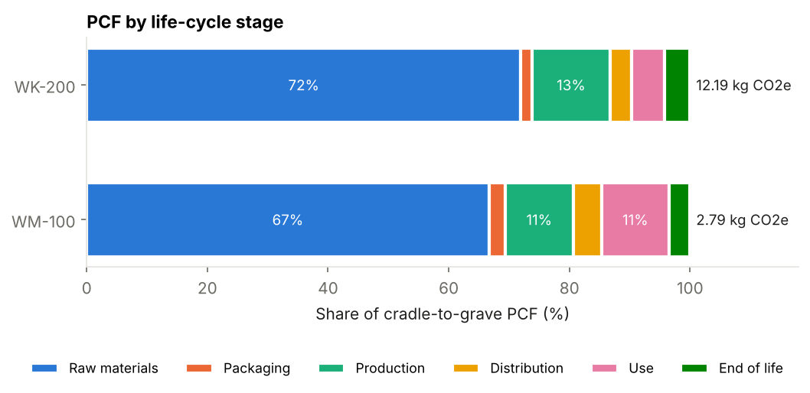
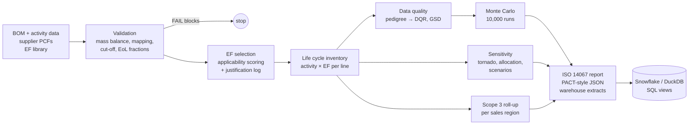
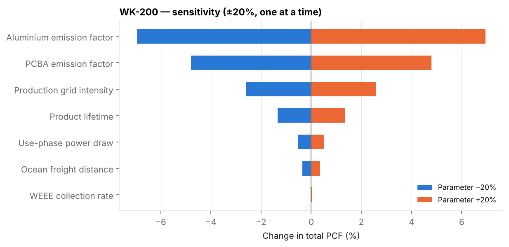
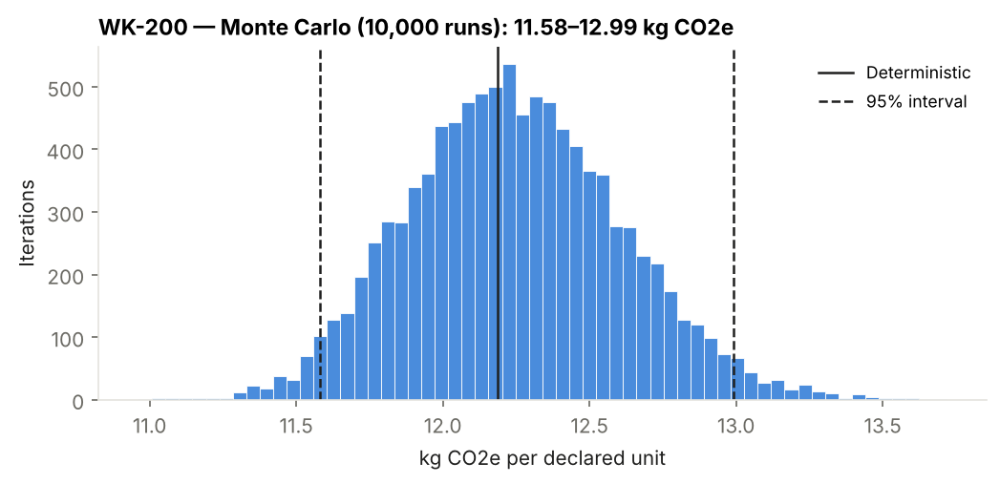
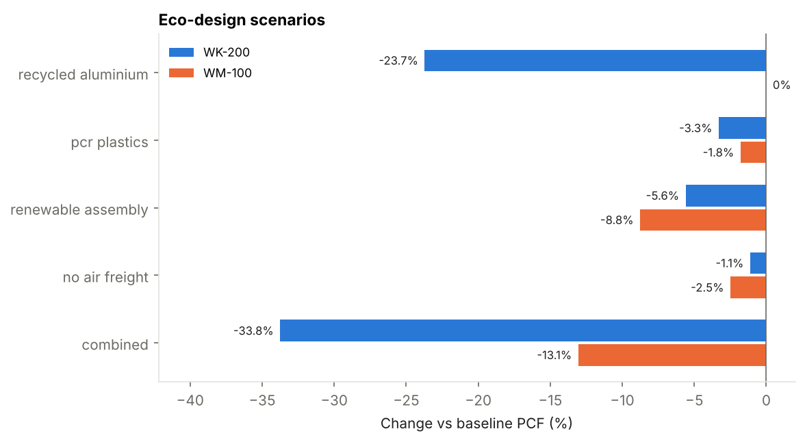
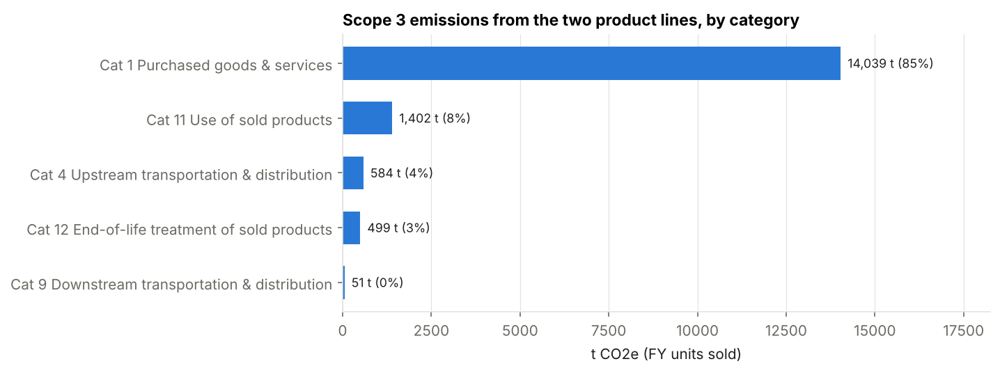

# pcf-lca-engine

**ISO 14067 product carbon footprint (PCF) engine for consumer electronics.** It takes a bill of materials, supplier emission data and activity data, and produces a cradle-to-grave footprint per declared unit. Along the way it selects emission factors with scored, logged justifications, rates data quality with a pedigree matrix, propagates uncertainty with Monte Carlo, tracks biogenic carbon separately and rolls everything up to the brand owner's Scope 3 inventory.

Modelled on two fictional products: a rechargeable wireless mouse (**WM-100**) and an aluminium wireless keyboard (**WK-200**).



## Results

| Product | PCF (kg CO2e / unit) | 95% interval | Primary data share | DQR | #1 hotspot |
|---|---|---|---|---|---|
| WM-100 wireless mouse, 4-year use | **2.79** | 2.69 – 2.94 | 45% | 1.72 (very good) | Main PCBA (supplier PCF), 31% |
| WK-200 wireless keyboard, 5-year use | **12.19** | 11.58 – 12.99 | 6% | 1.88 (very good) | Aluminium top case, 39% |

- **Raw materials dominate** (67–72%). The keyboard's CNC-machined aluminium case alone is 4.75 kg CO2e, because China-sourced primary aluminium and 15% machining scrap stack up.
- **Eco-design levers:** moving to 75% recycled aluminium cuts the keyboard by **24%**. All levers combined cut the keyboard by **34%** and the mouse by **13%**.
- **Scope 3 (FY2025, 2.9 M units):** 16,576 t CO2e, of which **85% is Cat 1**. A spend-based estimate overstates the mouse's Cat 1 by **200%**, which shows why product-level data matters.

## Pipeline



## Coverage map

| Area | Implementation |
|---|---|
| **LCA/PCF calculation:** activity data, BOM data, emission factors | `src/pcf/calculator.py` builds a line-level inventory (55 lines per product): gross material input incl. process scrap, process energy, metered assembly, allocated overhead, inbound and outbound logistics (sea/air split), use phase, end of life |
| **ISO 14040/44** | Goal and scope in `config/study.yaml`; ISO 14044 allocation hierarchy (`allocation.py`); completeness, consistency, sensitivity and uncertainty checks in interpretation; mapping in [docs/01](docs/01_methodology_iso14040_44_14067.md) |
| **ISO 14067** | Declared unit, cradle-to-grave boundary, AR6 GWP100, cut-off criteria (mass **and** impact), biogenic carbon reported separately, recycling credits reported separately, report structure (`report.py`) |
| **Emission-factor assessment and applicability** | `ef_library.py` scores every candidate on geography, technology, time, reliability and completeness *in the context of the activity*, then picks the best and logs the runner-up plus a written justification ([docs/02](docs/02_emission_factor_selection.md)) |
| **LCI databases** (ecoinvent, Sphera/GaBi) | Pedigree matrix and cut-off system model mirror ecoinvent conventions; the flat EF library is designed to be swapped for licensed datasets ([docs/03](docs/03_lca_software_and_databases.md)) |
| **LCA platforms** (openLCA, SimaPro, Sphera, iPoint, Makersite) | Concept-by-concept mapping and a step-by-step guide to rebuilding the model in openLCA ([docs/03](docs/03_lca_software_and_databases.md)) |
| **Scope 3, product BOM, supplier emission data** | Stage-to-category mapping (Cat 1/4/9/11/12), per-region recalculation, spend-based comparison (`scope3.py`); supplier PCF acceptance rules and primary data share (PACT definition) ([docs/04](docs/04_scope3_and_supplier_data.md)) |
| **SQL, Snowflake, BI** | Star-schema DDL and reporting views that run unchanged on Snowflake and DuckDB (`sql/`), plus a Snowflake `COPY INTO` load script |
| **Pipeline testing and automation** | 34 pytest tests (unit, regression, reconciliation, Python ↔ SQL), blocking input validation, ruff, GitHub Actions CI that runs the full pipeline and uploads reports |

## Quick start

```bash
git clone https://github.com/<your-username>/pcf-lca-engine.git
cd pcf-lca-engine
pip install -e ".[dev]"

python -m pcf validate                     # 37 input checks; exits 1 on any FAIL
python -m pcf run                          # full pipeline -> reports/
python -m pcf calc WK-200                  # quick stage breakdown
python -m pcf calc WM-100 --use-region RNA # same product used in North America
python -m pcf select aluminium CN          # explain an emission-factor choice
python -m pcf run --scenario combined      # apply an eco-design scenario
python scripts/run_sql_local.py            # load extracts into DuckDB, print SQL views
pytest -q
```

Or use `make all` (validate → test → run → sql).

## Repository structure

```
config/
  study.yaml              goal & scope, cut-off, allocation, region hierarchy, EoL scenarios, Scope 3 mapping
  scenarios.yaml          eco-design scenarios (recycled Al, PCR plastics, renewable PPA, no air freight)
products/                 per-product declared unit, manufacturing, logistics, use-phase parameters
data/
  bom/                    bill of materials (mass, material class, process, origin, recycled content)
  emission_factors/       EF library with geography, reference year and pedigree scores
  activity/               process energy intensities + scrap rates; factory allocation keys
  suppliers/              supplier-specific cradle-to-gate PCFs
  sales/                  units sold by region (Scope 3 roll-up)
src/pcf/
  calculator.py           life cycle inventory and stage results
  ef_library.py           candidate search, applicability scoring, selection log
  uncertainty.py          pedigree matrix, DQR, GSD, Monte Carlo
  allocation.py           mass / units / economic allocation of factory overhead
  validation.py           blocking data-pipeline checks
  sensitivity.py          tornado, allocation sensitivity, scenario comparison
  scope3.py               PCF -> Scope 3 categories, spend-based comparison
  report.py               ISO 14067-structured report, PACT-style JSON
  pipeline.py, charts.py, __main__.py
sql/                      Snowflake/DuckDB schema, reporting views, Snowflake stage load
tests/                    34 tests
docs/                     methodology, EF selection guide, LCA tools mapping, Scope 3 & supplier data
reports/                  generated outputs (committed so results are visible on GitHub)
```

## Method highlights

### Emission-factor selection with an audit trail

Each BOM line is matched against every dataset of the same material class. Geography is scored against a region hierarchy (`CN → RAS → GLO`), and dataset age against the study year. Recycled content is blended between virgin and recycled datasets. Every choice lands in `ef_selection_log.csv`:

```
C01 Top case → EF-AL-CN-V (CN, 2021) for aluminium sourced in CN: geography exact match,
temporal score 2, technology score 1; preferred over EF-AL-GLO-V (2.10 vs 1.40)
```

### Data quality and uncertainty

Five pedigree indicators per line are converted to a 95% geometric standard deviation, `GSD95 = exp(√(ln²Ub + Σ ln²Ui))`, and propagated with 10,000 lognormal Monte Carlo draws. The contribution-weighted DQR uses PEF-style bands. The SQL view `v_data_quality_priorities` ranks lines by *share × DQR* to show which data to improve first.

### Supplier primary data

Supplier PCFs are accepted only if cradle-to-gate, no more than 3 years old and verified. When one is accepted it replaces the material and processing lines for that part, so nothing is counted twice. In this dataset:

| Supplier part | Decision | Reason |
|---|---|---|
| WM-100 main PCBA (2025, third-party) | ✅ accepted | meets all rules |
| WM-100 Li-ion cell (2024, self-declared) | ✅ accepted | reliability score 3 |
| WK-200 main PCBA (2019) | ❌ rejected | older than 3 years → secondary dataset used |
| WK-200 bottom case | ❌ rejected | gate-to-gate boundary would omit materials |

### Other ISO 14067 details handled

- **Process scrap:** gross input = net mass ÷ (1 − scrap rate).
- **Cut-off:** adhesives and labels are excluded only after both the mass test (0.28% / 0.37%) and a conservative impact test pass.
- **Biogenic carbon:** removal, end-of-life release, landfill storage and transfer to recycling are tracked for fibre packaging. The balance closes to zero and is reported outside the fossil total.
- **Allocation:** factory overhead is allocated by mass. Units and economic keys are tested and shift the keyboard by less than 2%.
- **Electricity:** location-based in the baseline. The PPA solar factor appears only in a named scenario.

## Sensitivity and scenarios

| | |
|---|---|
|  |  |



| Scenario | WM-100 | WK-200 |
|---|---|---|
| 75% recycled aluminium top case | — | −23.7% |
| 75% PCR plastics in housings | −1.8% | −3.3% |
| Renewable PPA at assembly plant | −8.8% | −5.6% |
| No air freight | −2.5% | −1.1% |
| **Combined** | **−13.1%** | **−33.8%** |

## Scope 3 roll-up



| Category | t CO2e | Share |
|---|---|---|
| Cat 1 Purchased goods & services | 14,039 | 84.7% |
| Cat 11 Use of sold products | 1,402 | 8.5% |
| Cat 4 Upstream transport | 584 | 3.5% |
| Cat 12 End-of-life treatment | 499 | 3.0% |
| Cat 9 Downstream transport | 51 | 0.3% |

Use phase and end of life are recalculated per market: North American sales use the RNA grid (0.370 vs 0.255 kg/kWh) and a lower WEEE collection rate.

## Outputs per product (`reports/<product>/`)

| File | Content |
|---|---|
| `PCF_report.md` | ISO 14067-structured study report: goal and scope, results, hotspots, LCI sources, interpretation, data quality, limitations |
| `inventory.csv` | Every inventory line: activity, EF, kg CO2e, data type, five pedigree scores, DQR, GSD95 |
| `ef_selection_log.csv` | Selected dataset, applicability score, all candidates, justification |
| `supplier_data_decisions.csv` | Accept/reject decision and reason for each supplier PCF |
| `biogenic_carbon.csv`, `recycling_credits_reported_separately.csv` | Flows reported outside the headline total |
| `sensitivity_tornado.csv`, `allocation_sensitivity.csv`, `monte_carlo_summary.json` | Interpretation results |
| `pact_footprint.json` | PACT-style ProductFootprint record for supplier/customer data exchange |
| `hotspots.png`, `tornado.png`, `monte_carlo.png` | Charts |

Portfolio-level: `pcf_summary.csv`, `scenario_comparison.csv`, `scope3_*.csv`, `validation_report.csv`, and `warehouse/` extracts for the SQL layer.

## SQL layer (Snowflake / DuckDB)

`sql/01_schema.sql` (dimensions + facts) and `sql/02_views.sql` use ANSI SQL that runs on both engines:

| View | Purpose |
|---|---|
| `v_pcf_kpis` | PCF, primary data share, weighted DQR per product |
| `v_pcf_by_stage` | Stage breakdown with window-function shares |
| `v_scope3_by_category` | Per-unit inventory × units sold, by GHG Protocol category |
| `v_scope3_by_product_region` | Emissions and g CO2e per € revenue by product and market |
| `v_data_quality_priorities` | Data-improvement backlog ranked by share × DQR |
| `v_ef_usage` | Which datasets drive the footprint |

`sql/snowflake/load_from_stage.sql` loads the extracts with `PUT` / `COPY INTO` and finishes with a reconciliation query. A test checks that the SQL totals match the Python totals.

## Testing and CI

- **Unit:** unit conversions, geography and temporal scoring, EF fallback, recycled-content blending, pedigree → GSD, allocation shares.
- **Method:** stage totals equal line sums, scrap handling, supplier accept/reject rules, renewable override scope, biogenic balance closes, end-of-life mass is conserved.
- **Validation:** deliberately broken inputs (mass imbalance, unmapped material, recycled content over 100%, cut-off breach, negative EF) must fail, and the pipeline must refuse to run.
- **Regression:** baseline totals pinned, so any data or method change has to be made deliberately.
- **Reconciliation:** Scope 3 roll-up equals the sum of units × PCF; DuckDB views equal the Python results.
- **CI** (`.github/workflows/ci.yml`): ruff → validate → pytest → full pipeline → SQL smoke test, on Python 3.10 and 3.12, with reports uploaded as an artifact.

## Data and limitations

- **Products are fictional.** Emission factors are **illustrative values in plausible ranges**, not ecoinvent or Sphera data, which are licensed. Results show the method and should not be read as real product footprints.
- Monte Carlo covers emission-factor uncertainty only; activity-data uncertainty and correlations are not modelled.
- One representative Asia → Europe logistics route is used for all markets.
- Not critically reviewed. A public comparative claim would need ISO/TS 14071 review and a CFP-PCR.

## Documentation

1. [Methodology: ISO 14040/44 and ISO 14067](docs/01_methodology_iso14040_44_14067.md)
2. [Emission-factor assessment and dataset applicability](docs/02_emission_factor_selection.md)
3. [LCA software and LCI databases mapping](docs/03_lca_software_and_databases.md)
4. [Scope 3 and supplier emission data](docs/04_scope3_and_supplier_data.md)

## License

MIT
